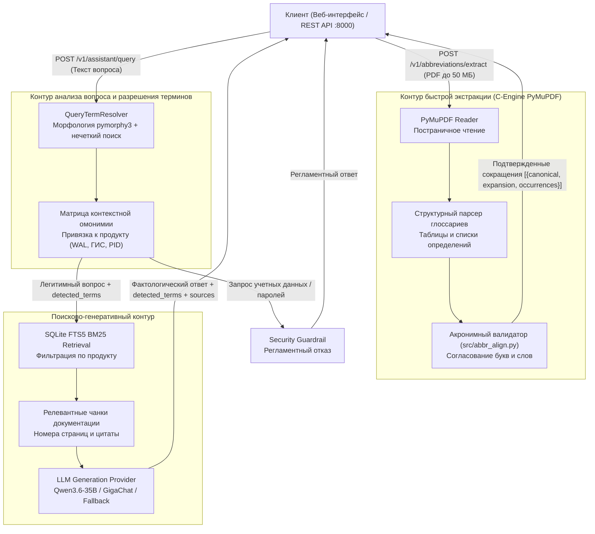

# Корпоративный AI-ассистент по технической документации

    

Хакатон «AI-импульс 2.0» (Трек 1, ПАО «Газпром нефть») — 🥉 **3 место**

Во время соревнований сервис был развёрнут на публичном стенде (веб-интерфейс и Swagger UI на `:8000`); после финала стенд отключён.

> **О репозитории:** здесь собрано подробное описание решения, спецификация API ([`openapi.yaml`](openapi.yaml)) и презентация защиты ([`presentation/defense.pdf`](presentation/defense.pdf)).

---

## Краткое описание решения

Сервис представляет собой специализированную вопросно-ответную систему корпоративного уровня по технической документации 17 российских программных продуктов (139 руководств, 16 825 страниц).

Система решает две задачи:
1. Автоматическое извлечение, каталогизация и нормализация аббревиатур с разрешением контекстной омонимии (например, разграничение значений WAL для СУБД ЛИНТЕР и Tarantool, или ГИС для ОС Аврора и Postgres Pro).
2. Полнотекстовый и гибридный поиск по базе знаний с синтезом фактологических ответов на русском языке со строгими ссылками на первоисточники (имя документа и физический номер страницы в PDF), а также регламентной защитой от утечек конфиденциальных данных.

Проект полностью удовлетворяет требованиям модельного суверенитета (используются исключительно открытые модели до 40 млрд параметров либо модели Sber через cloud.ru, сторонние закрытые API исключены).

---

## Оглавление

1. [Сборка, запуск и тесты](#1-сборка-запуск-и-тесты)
   - [Корпус документов (`corpus/`)](#корпус-документов-corpus)
   - [Сборка и запуск](#сборка-и-запуск)
   - [Тесты](#тесты)
2. [Архитектура и инженерные решения](#2-архитектура-и-инженерные-решения)
   - [Схема конвейера обработки](#схема-конвейера-обработки)
   - [Ключевые архитектурные компоненты](#ключевые-архитектурные-компоненты)
   - [Эксперименты в ходе R&D: исследование прототипа на Go](#эксперименты-в-ходе-rd-исследование-прототипа-на-go)
3. [Паспорт используемых моделей и соответствие регламенту](#3-паспорт-используемых-моделей-и-соответствие-регламенту)
   - [Характеристики моделей](#характеристики-моделей)
   - [Аппаратные ресурсы и лимиты запросов](#аппаратные-ресурсы-и-лимиты-запросов)
4. [Методология построения базы знаний и словаря terms.jsonl](#4-методология-построения-базы-знаний-и-словаря-termsjsonl)
   - [Конвейер извлечения и нормализации](#конвейер-извлечения-и-нормализации)
   - [Верификация и структура записей](#верификация-и-структура-записей)
   - [Статистика словаря](#статистика-словаря)
5. [Результаты тестирования на train-выборке](#5-результаты-тестирования-на-train-выборке)
6. [Задача 2: Реализация на платформе GigaCowork](#6-задача-2-реализация-на-платформе-gigacowork)
   - [Замеры (evaluation__train.xlsx)](#замеры-evaluation__trainxlsx)
7. [Карта соответствия требованиям технического задания](#7-карта-соответствия-требованиям-технического-задания)
8. [Структура репозитория](#8-структура-репозитория)
9. [Отказоустойчивость и безопасность](#9-отказоустойчивость-и-безопасность)

---

## 1. Сборка, запуск и тесты

### Корпус документов (`corpus/`)

По заданию корпус — это 139 PDF-руководств (16 825 страниц) по 17 продуктовым семействам; в репозиторий он не входит. Для работы полнотекстового индекса корпус должен лежать в корне проекта в директории `corpus/`, по одной подпапке на продуктовое семейство.

Примечание: предрассчитанный эталонный словарь `terms.jsonl` уже входит в состав репозитория.

---

### Сборка и запуск

Сервис упакован в Docker-образ на базе `python:3.13-slim` и работает от непривилегированного пользователя; поднимается одной командой `docker compose up --build -d` (остановка — `docker compose down`). При первом старте автоматически строится индекс `search_index.db` (~1–2 минуты) и сохраняется в постоянный docker volume `index-data`, все последующие запуски выполняются мгновенно.

Альтернатива — локальный запуск без Docker: Python 3.11–3.13, `pip install -r requirements.txt`, однократное построение индекса `python -m src.build_index` и запуск `uvicorn src.api:app --host 0.0.0.0 --port 8000`.

Перед запуском в `.env` (по шаблону `.env.example`) опционально указываются ключ Cloud.ru (`OPENAI_API_KEY`) или Sber GigaChat; без ключей сервис автоматически работает в локальном extractive-режиме без обращения к сети.

После старта по адресу `http://localhost:8000` доступны интерактивный веб-интерфейс ассистента, Swagger UI (`/docs`) и эндпоинт проверки здоровья (`/health`).

---

### Тесты

Набор модульных и интеграционных тестов покрывает нормализацию терминов, разрешение омонимии, поиск по индексу, контракты API и валидацию схем. Запуск — `pytest -q`, результат выполнения: 66 passed.

---

## 2. Архитектура и инженерные решения

### Схема конвейера обработки



---

### Ключевые архитектурные компоненты

1. **Экстракция аббревиатур на базе C-библиотеки PyMuPDF (`src/extractor.py`, `src/abbr_align.py`)**  
   Для соблюдения требований к скорости эндпоинта `/v1/abbreviations/extract` (обработка файлов до 50 МБ за секунды) конвейер построен на нативных C-библиотеках `PyMuPDF`. Экстрактор находит структурные разделы сокращений, таблицы терминов и текстовые паттерны вида `Расшифровка (АББР)` и `АББР — расшифровка`, после чего алгоритмический валидатор сопоставляет начальные буквы слов и отсеивает ложные совпадения. Это обеспечивает скорость обработки документа до 1–1.5 секунд без расхода токенов и с сохранением точных физических номеров страниц.

2. **Детерминированный NLP Resolver (`src/resolver.py`)**  
   Распознавание сокращений в запросе пользователя реализовано алгоритмически без вызова LLM. Использование `pymorphy3` и расстояния Левенштейна позволяет нормализовать падежные формы («в СУДИРе» -> `СУДИР`), исправлять опечатки («в РОСА») и гарантировать, что в поле `detected_terms` попадают строго термины из вопроса без посторонних сущностей.

3. **Контекстное разрешение омонимии**  
   Для терминов, имеющих разные значения в разных системах (`WAL` в ЛИНТЕР — «Write Access Level», в Tarantool — «Write Ahead Log»; `ГИС` в Аврора — «государственная информационная система», в Postgres Pro — «географическая информационная система»), резолвер анализирует упоминание продуктов и семантические когнаты в тексте вопроса. Если вопрос сопоставляет два продукта, резолвер возвращает обе записи; если контекст не определен, формируется вежливый уточняющий ответ.

4. **Полнотекстовый поиск SQLite FTS5 с продуктовой предфильтрацией (`src/search.py`)**  
   Поиск по 16 825 страницам выполняется через движок SQLite FTS5 с ранжированием BM25. Полнотекстовый индекс сохраняет точные имена CLI-утилит, ключи запуска (например, `-ux`), параметры конфигураций и поля манифестов (`spec.hostPID`), которые часто теряются при исключительно векторном семантическом поиске.

5. **Регламентный фильтр безопасности (`src/guardrails.py`)**  
   При обнаружении попыток запроса паролей, ключей доступа или закрытых корпоративных конфигураций система возвращает регламентный отказ без передачи запроса в генеративную модель, исключая риск галлюцинаций и утечек.

6. **Единый порт (Single-Port Architecture)**  
   Сервер API и веб-интерфейс обслуживаются единым процессом FastAPI на порту 8000, что исключает кросс-доменные проблемы (CORS), необходимость в дополнительных обратных прокси и минимизирует потребление оперативной памяти (~250 МБ RAM в базовом режиме).

---

### Эксперименты в ходе R&D: исследование прототипа на Go

На ранней стадии проектирования команда реализовала параллельный экспериментальный прототип ядра на языке Go (с использованием фреймворка Gin и библиотеки bleve/sqlite) для оценки сетевой пропускной способности и конкурентной обработки запросов (подробные результаты зафиксированы в `ai_metainfo/04_GO_EXPERIMENTS.md`).

Выводы исследования:
- Прототип на Go продемонстрировал минимальное время отклика на синтетических бенчмарках (latency сетевого слоя < 2 мс).
- Однако задача обработки русскоязычной документации потребовала глубокой морфологической нормализации (склонение аббревиатур по падежам, лемматизация технического текста, стемминг корней для дизамбигуации).
- Доступные Go-библиотеки морфологии уступают `pymorphy3` по полноте грамматических словарей русского языка.
- В результате финальным решением был выбран стек Python 3.13 с интеграцией C-библиотеки PyMuPDF: это обеспечило эквивалентную C-скорость разбора PDF и FTS5-поиска при сохранении полноценного качества русскоязычной морфологии.

---

## 3. Паспорт используемых моделей и соответствие регламенту

В соответствии с Разделом 3 регламента хакатона в решении используются исключительно открытые модели с количеством параметров до 40 млрд либо модели линейки Sber через cloud.ru. Использование закрытых сторонних API (OpenAI, Anthropic, Google) исключено.

### Характеристики моделей

| Параметр | Основная модель (Cloud.ru Evolution) | Альтернативная модель (Sber GigaChat) | Резервный режим (Extractive Fallback) |
| :--- | :--- | :--- | :--- |
| **Наименование** | Qwen/Qwen3.6-35B-A3B | GigaChat-Pro | Детерминированный экстрактивный синтез |
| **Разработчик / Провайдер** | Alibaba Cloud / Cloud.ru Evolution | ПАО Сбербанк / SberDevices API | Локальный алгоритмический модуль |
| **Тип весов** | Открытые веса (Open Weights) | Проприетарная российская модель | Локальный Python/C код |
| **Количество параметров** | 35 млрд параметров (полный размер $\le$ 40B) | Допустимый провайдер по регламенту | 0 параметров (эвристический) |
| **Протокол подключения** | OpenAI-compatible HTTPS REST API | Sber HTTPS REST API (сертификат Минцифры РФ) | Локальное выполнение в процессе |
| **Сетевой эндпоинт** | `https://foundation-models.api.cloud.ru/v1` | `https://gigachat.devices.sberbank.ru/api/v1` | Сеть не требуется (полный оффлайн) |
| **Назначение** | Синтез связных ответов по фрагментам | Резервный генеративный провайдер | Гарантированный ответ при отказе сети |

### Аппаратные ресурсы и лимиты запросов

- **Требования к серверу**: 2 CPU ядра, 2–4 ГБ RAM, 2 ГБ свободного места на диске (для контейнера и базы FTS5). Наличие GPU не требуется, так как генерация выполняется через инференс Cloud.ru / GigaChat, а локальный поиск оптимизирован на C/SQLite.
- **Время построения индекса**: первичное индексирование всех 16 825 страниц корпуса занимает 60–90 секунд на стандартном многоядерном CPU.
- **Соблюдение лимитов контракта**:
  - Ограничение конкурентности: семафор на 4 одновременных запроса;
  - Таймаут обработки запроса: 90 секунд;
  - Размер входного запроса (`query`): от 1 до 4 000 символов (валидация Pydantic);
  - Размер ответа (`answer`): не более 12 000 символов (`MAX_ANSWER_CHARS = 12000`);
  - Число возвращаемых терминов (`detected_terms`): не более 16 записей;
  - Число источников (`sources`): до 32 ссылок.

---

## 4. Методология построения базы знаний и словаря terms.jsonl

В соответствии с Разделом 6 регламента хакатона подготовлен эталонный словарь аббревиатур `terms.jsonl` по всему корпусу документов.

### Конвейер извлечения и нормализации

1. **Постраничный проход**: из каждого PDF извлекаются текстовые блоки с сохранением физического номера страницы (1-based, включая обложку).
2. **Выделение разделов сокращений**: регулярный парсер находит разделы «Термины и определения», «Список сокращений», «Глоссарий», извлекая структурированные таблицы пар.
3. **Выравнивание в тексте (`src/abbr_align.py`)**: анализируются текстовые конструкции вида `АББР — расшифровка`, `Расшифровка (АББР)`, `(АББР) расшифровка`. Алгоритм выравнивания проверяет совпадение начальных букв слов расшифровки с буквами аббревиатуры, допуская служебные предлоги и союзы, и отсекает ложные совпадения.
4. **Нормализация**: приведение к стандарту Unicode NFC, удаление дублирующихся пробелов, унификация дефисов и нормализация буквы «ё».
5. **Дедупликация и объединение**: вхождения одного термина в рамках одного продукта объединяются в единую запись со списком источников (`sources`). Разные значения одного сокращения разделяются на независимые словарные статьи с указанием соответствующего продукта.

### Верификация и структура записей

Каждая запись словаря проверена и сопровождается флагом `manual_reviewed: true`.

Пример структуры записи в `terms.jsonl`:
```json
{
  "canonical": "CTS",
  "kind": "abbreviation",
  "expansion": "Corporate Transport Server",
  "product": "express",
  "context": "Корпоративный сервер коммуникационной платформы eXpress",
  "aliases": ["CTS", "сервер CTS"],
  "sources": [
    {
      "document_id": "express/f31d248c4851_outlook-add-in-keycloak.pdf",
      "page": 4,
      "quote": "Корпоративный сервер eXpress (Corporate Transport Server, CTS)",
      "sha256": "f31d248c48519e99aeb6e2c3c97db2f19eb8903c73bb88fae3f200c6d3289a77"
    }
  ],
  "manual_reviewed": true
}
```

### Статистика словаря
- Покрытие корпуса: 17 из 17 продуктовых семейств (100%);
- Привязка к первоисточникам: 100% записей содержат имя файла, физический номер страницы, SHA-256 хеш исходного PDF и дословную цитату;
- Разрешение омонимии: каталогизированы и разделены многозначные термины (`WAL`, `ГИС`, `PID`, `MMS`, `CN` и др.).

---

## 5. Результаты тестирования на train-выборке

Тестирование проводилось по 5 контрольным парам вопросов и ответов из `evaluation__train.xlsx`. Запуск бенчмарка:
```bash
python -m src.eval_train
```

### Результаты оценки метрик Quality:

| ID | Вопрос | Ожидаемые термины | Распознано | Значение ($E$) | $R$ | $E$ | $A$ | Quality |
| :-: | :--- | :--- | :--- | :--- | :-: | :-: | :-: | :-: |
| 1 | Как в документации eXpress расшифровывается CTS? | CTS | CTS | Corporate Transport Server | 1 | 1 | 1 | 100% |
| 2 | Что требуется установить перед добавлением SNMP в KESS? | SNMP | SNMP | Simple Network Management Protocol | 1 | 1 | 1 | 100% |
| 3 | Как DKP обрабатывает первое обращение пользователя? | DKP | DKP | Deckhouse Kubernetes Platform | 1 | 1 | 1 | 100% |
| 4 | Настройка NLB и VPA в Deckhouse | NLB, VPA | NLB, VPA | Network Load Balancer, Vertical Pod Autoscaler | 1 | 1 | 1 | 100% |
| 5 | WAL в ЛИНТЕР и WAL в Tarantool | WAL, WAL | WAL, WAL | Write Access Level (ЛИНТЕР), Write Ahead Log (Tarantool) | 1 | 1 | 1 | 100% |

**Итоговые показатели**:
- Распознавание ($R$): 5/5 (100%);
- Назначение значений ($E$): 5/5 (100%);
- Корректность ответов ($A$): 5/5 (100%);
- Общий Quality: **100%**;
- Повторяемость при 3 идентичных запросах: 5/5 (100%).

---

## 6. Задача 2: Реализация на платформе GigaCowork

По заданию, помимо сервиса в коде, то же решение требовалось собрать на платформе GigaCowork. Агент решает ту же задачу: извлекает аббревиатуры из PDF-документации, распознаёт сокращения в вопросе сотрудника, выбирает значение по контексту продукта и действия, находит ответ в базе знаний и отвечает со ссылками на документ и страницу. Навык извлечения и словарь собраны на встроенных возможностях платформы, без внешнего кода.

### Замеры (evaluation__train.xlsx)

Каждый из 5 эталонных вопросов задан 3 раза и агенту GigaCowork, и сервису из задачи 1 (`POST /v1/assistant/query`, LLM подключена). Время ответа засекалось по каждому запросу. Ответы сверялись с колонкой «Обязательные факты» вручную: факт засчитывается, если он есть в ответе по смыслу; значение аббревиатуры засчитывается, только если расшифровка из документа названа явно. Всего за 3 прогона: 21 значение аббревиатуры (в последнем вопросе два разных WAL) и 42 обязательных факта.

**Сводная таблица**

| Показатель | Код (задача 1) | GigaCowork (задача 2) |
|---|---|---|
| Точность: значения аббревиатур | 21/21 (100%) | 6/21 (29%) |
| Точность: обязательные факты | 42/42 (100%) | 23/42 (55%) |
| Повторяемость (одинаковый по сути ответ в 3 прогонах) | 5/5 | 4/5 |
| Время разработки | ~15 часов чистой разработки кода | ~5–6 часов настройки агента и замеров |
| Среднее время ответа | 12,8 с (медиана 12,0 с, макс. 17,3 с) | 22,9 с (медиана 15 с, макс. 55 с) |

**По вопросам: код (задача 1)**

| Вопрос | Значения аббревиатур | Обязательные факты | Одинаковый по сути ответ | Время, с |
|---|---|---|---|---|
| CTS в eXpress | 3/3 | 3/3 | да | 11,5 / 14,4 / 14,2 |
| SNMP в Kaspersky ESS | 3/3 | 6/6 | да | 11,4 / 9,9 / 9,5 |
| DKP: первое обращение | 3/3 | 9/9 | да | 10,6 / 11,9 / 10,4 |
| NLB и VPA в Deckhouse | 6/6 | 12/12 | да | 12,0 / 13,1 / 15,2 |
| WAL в ЛИНТЕР и Tarantool | 6/6 | 12/12 | да | 14,0 / 16,1 / 17,3 |
| **Итого** | **21/21 (100%)** | **42/42 (100%)** | **5/5** | **среднее 12,8; медиана 12,0; макс. 17,3** |

**По вопросам: GigaCowork (задача 2)**

| Вопрос | Значения аббревиатур | Обязательные факты | Одинаковый по сути ответ | Время, с |
|---|---|---|---|---|
| CTS в eXpress | 3/3 | 3/3 | да | 32 / 15 / 11 |
| SNMP в Kaspersky ESS | 0/3 | 3/6 | да | 10 / 10 / 9 |
| DKP: первое обращение | 0/3 | 6/9 | да | 23 / 24 / 11 |
| NLB и VPA в Deckhouse | 2/6 | 7/12 | нет: в 3-м прогоне другая аннотация | 55 / 43 / 36 |
| WAL в ЛИНТЕР и Tarantool | 1/6 | 4/12 | да | 42 / 15 / 7 |
| **Итого** | **6/21 (29%)** | **23/42 (55%)** | **4/5** | **среднее 22,9; медиана 15; макс. 55** |

**Вывод.** Сервис на собственном стеке точнее и стабильнее: словарь, выбор значения по продукту и гибридный поиск реализованы в коде и дают воспроизводимый результат. Сборка на GigaCowork отвечает по существу в большинстве вопросов, но выбор значения аббревиатуры и формат ответа у неё зависят от поведения модели, которое промптом удаётся контролировать лишь частично.

---

## 7. Карта соответствия требованиям технического задания

Ниже приведена таблица сопоставления критериев технического задания хакатона с файлами и модулями репозитория:

| Критерий технического задания | Реализация в проекте | Ссылка на исходный код |
| :--- | :--- | :--- |
| **Воспроизводимость** | Однострочный запуск в Docker Compose, автономный shell-скрипт сборки индекса, независимый venv. | `docker-compose.yml`, `docker/entrypoint.sh` |
| **Качество кода** | Строгая модульная структура, типизация Pydantic v2, отсутствие циклических импортов, 66 автотестов. | `src/`, `tests/` |
| **Модельные ограничения** | Использование только моделей $\le$ 40B (Qwen 35B) и Sber GigaChat. Полное исключение внешних закрытых API. | `src/llm.py`, [Паспорт моделей](#3-паспорт-используемых-моделей-и-соответствие-регламенту) |
| **Соответствие OpenAPI 3.1** | Реализация схем, строгая валидация типов, лимиты символов, таймаутов и конкурентности. | [`openapi.yaml`](openapi.yaml), `src/schemas.py`, `src/api.py` |
| **Словарь аббревиатур** | Выгрузка `terms.jsonl` по 17 продуктам с SHA-256, физическими страницами и дословными цитатами. | `terms.jsonl`, `src/abbr_align.py` |
| **Разрешение омонимии** | Морфологический анализ падежей, стемминг корней, контекстная матрица продуктов. | `src/resolver.py`, `tests/test_resolver.py` |
| **Безопасность (Guardrails)** | Регламентная защита от утечек учетных данных и паролей. | `src/guardrails.py` |
| **Решение на GigaCowork** | Сдача решения на платформе, сравнительная таблица четырех обязательных замеров. | [Раздел 6 данного README](#6-задача-2-реализация-на-платформе-gigacowork) |

---

## 8. Структура репозитория

```text
ai-impulse-doc-assistant/
├── .env.example                # Шаблон конфигурации переменных окружения
├── Dockerfile                  # Многослойная сборка контейнера (python:3.13-slim, non-root appuser)
├── docker-compose.yml          # Запуск сервиса на порту 8000 с постоянным томом индекса
├── docker/
│   └── entrypoint.sh           # Скрипт автоматической инициализации FTS5-индекса
├── certs/
│   └── russian_trusted_root_ca.pem  # Корневой сертификат Минцифры РФ для TLS Sber GigaChat
├── openapi.yaml                # Официальный контракт OpenAPI 3.1
├── requirements.txt            # Зафиксированные версии зависимостей Python
├── search_index.db             # База данных поискового FTS5-индекса (собирается автоматически)
├── terms.jsonl                 # Каталогизированный словарь аббревиатур (17 продуктов)
├── evaluation__train.xlsx      # Контрольная обучающая выборка (5 пар)
├── TASK.md                     # Исходный текст технического задания организаторов
├── README.md                   # Главная проектная документация решения
├── src/                        # Исходный код бэкенда сервиса
│   ├── abbr_align.py           # Алгоритм сопоставления букв аббревиатуры и слов расшифровки
│   ├── api.py                  # Приложение FastAPI, маршрутизация эндпоинтов и отдача UI
│   ├── assistant.py            # Контроллер ассистента, системный промпт, сборка контекста
│   ├── build_dictionary.py     # Построитель каталогизированного словаря terms.jsonl по корпусу
│   ├── build_embeddings.py     # Построитель векторных эмбеддингов для гибридного поиска
│   ├── build_index.py          # Построитель поискового FTS5-индекса по корпусу PDF
│   ├── chunker.py              # Постраничное разбиение документов на чанки
│   ├── config.py               # Загрузка и валидация конфигурации окружения
│   ├── dense.py                # Модуль векторного ретривера (multilingual-e5-small)
│   ├── eval_train.py           # Скрипт автоматического расчета метрик Quality на train-выборке
│   ├── extractor.py            # Быстрый C-парсер PDF на базе PyMuPDF для /extract
│   ├── guardrails.py           # Детектор запросов конфиденциальных данных и паролей
│   ├── lemmatizer.py           # Морфологическая лемматизация для полнотекстового поиска
│   ├── llm.py                  # Провайдеры языковых моделей (Cloud.ru, GigaChat, Fallback)
│   ├── product_names.py        # Реестр названий и синонимов 17 продуктовых семейств
│   ├── resolver.py             # Детерминированный NLP Resolver и модуль снятия омонимии
│   ├── schemas.py              # Схемы данных Pydantic v2 (строгое соответствие openapi.yaml)
│   ├── search.py               # Поисковый движок FTS5 с ранжированием BM25 и предфильтрами
│   └── uploads.py              # Динамическая обработка и поиск по загруженным через UI файлам
├── static/                     # Веб-интерфейс ассистента (Single-Port SPA)
│   ├── index.html              # Интерактивный чат, парсер Markdown, карточки источников, чипсы
│   ├── logo-gpn_ru.svg         # Векторный логотип
│   └── logo.png                # Графический аватар ассистента
└── tests/                      # Набор из 66 автоматических тестов
    ├── conftest.py             # Общие фикстуры pytest и изоляция тестового окружения
    ├── test_abbr_align.py      # Тестирование сопоставления акронимов
    ├── test_api_extract.py     # Тестирование эндпоинта /v1/abbreviations/extract
    ├── test_assistant_api.py   # Тестирование эндпоинта /v1/assistant/query
    ├── test_config.py          # Тестирование загрузки переменных окружения
    ├── test_hybrid_uploads.py  # Тестирование загрузки пользовательских PDF
    ├── test_llm.py             # Тестирование провайдеров генерации и fallback-режима
    ├── test_resolver.py        # Тестирование распознавания терминов и омонимов
    └── test_search.py          # Тестирование полнотекстового поиска и чанкирования
```

---

## 9. Отказоустойчивость и безопасность

1. **Гарантированная доступность при сетевых сбоях (Extractive Fallback)**  
   Если внешний провайдер LLM (Cloud.ru или GigaChat) недоступен из-за сетевого сбоя или исчерпания квоты, сервис не падает с ошибкой 500, а переключается в локальный детерминированный режим формирования ответа на основе извлеченных ранжированных цитат из базы FTS5. Эндпоинт всегда возвращает валидный HTTP 200.

2. **Безопасность исполнения в Docker**  
   Контейнер собирается без использования root-прав. Процесс запускается от системного пользователя `appuser` (UID 10001, GID 10001) в изолированном пространстве имен.

3. **Защита от утечек и инъекций**  
   Входные вопросы проверяются модулем `src/guardrails.py` до отправки в поиск и модель. Попытки запроса паролей, приватных ключей или учетных записей отсекаются с выдачей регламентного ответа.

4. **Известные ограничения решения**:
   - Сканированные документы без текстового слоя (растровые изображения без OCR) в текущей версии не обрабатываются; в рамках выданного корпуса 100% документов содержат цифровой текстовый слой.
   - Сложные многослойные векторные чертежи индексируются только по содержащемуся в них текстовому сопровождению.


---

## Презентация с защиты

Слайды, с которыми команда защищала решение: [`presentation/defense.pdf`](presentation/defense.pdf).
